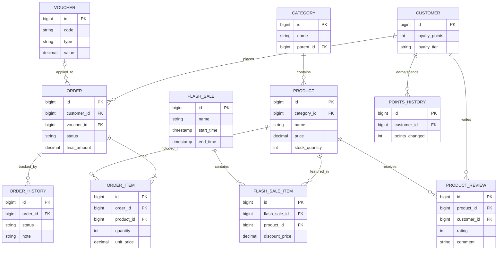

# Phân tích Thiết kế Module E-Commerce cho V-ERP Lite

Dựa trên kiến trúc hiện tại của dự án **V-ERP Lite** (Backend: Quarkus, Frontend: React/Vite, Database: MariaDB, Auth: Keycloak), đây là bản thiết kế để tích hợp thêm các tính năng E-Commerce (Thương mại điện tử / Quản lý đơn hàng) mà vẫn đảm bảo tính "lite" và chuẩn Multi-tenant của hệ thống.

> [!IMPORTANT]
> **Phương pháp tiếp cận (Monolith vs Microservices):**
> Do định hướng của dự án là "lite" (như quy định trong `AGENTS.md` là không dùng Redis, Message Queue,...), tính năng E-Commerce nên được xây dựng dưới dạng một **Module (Package) bên trong Backend hiện tại** thay vì tách ra thành Microservice riêng. Điều này giúp tận dụng lại toàn bộ hệ thống xác thực Keycloak, cơ chế Multi-tenant (`tenant_id`), và dễ dàng truy xuất thông tin `Customer` mà không cần xử lý Distributed Transaction phức tạp.

## Danh sách Tính năng (Feature Breakdown)

Hệ thống E-Commerce sẽ được chia thành các nhóm tính năng chính sau đây:

### 1. Quản lý Sản phẩm & Danh mục (Catalog Management)
* **Tạo và cấu hình sản phẩm:** Tên, mô tả chi tiết, hình ảnh đại diện (hoặc URL ảnh).
* **Định giá (Pricing):** Đặt giá bán cơ bản (Base Price), giá khuyến mãi (Sale Price) có thể áp dụng theo thời gian.
* **Biến thể (Variants):** Hỗ trợ tạo các thuộc tính sản phẩm (VD: Màu sắc, Kích cỡ) và cấu hình giá/kho riêng cho từng biến thể.
* **Phân loại:** Phân nhóm sản phẩm theo Category (Danh mục cha/con) và Tags (Thẻ) để khách hàng dễ dàng tìm kiếm.

### 2. Quản lý Kho cơ bản (Basic Inventory)
* **Theo dõi tồn kho (Stock Tracking):** Số lượng tồn kho hiện tại (Stock quantity) và mức tồn kho tối thiểu (Low stock threshold).
* **Cảnh báo hết hàng:** Tự động báo đỏ hoặc ẩn sản phẩm khi số lượng tồn bằng 0.
* **Giữ chỗ (Stock Reservation):** Trừ tạm tồn kho khi khách hàng bỏ vào giỏ/tiến hành thanh toán để tránh bán lố (overselling).

### 3. Mua sắm & Đặt hàng (Cart & Checkout)
* **Giỏ hàng (Shopping Cart):** Tính toán tạm tính, phí giao hàng (Shipping fee) và thuế (VAT).
* **Luồng đặt hàng (Checkout Flow):** Nhập thông tin giao hàng, áp dụng mã giảm giá (Discount/Voucher).
* **Tính toán tổng tiền:** Hệ thống tự động tính toán chính xác tổng tiền cuối cùng dựa trên số lượng, đơn giá và các chi phí phụ.

### 4. Quản lý Thanh toán (Payments)
* **Thanh toán Offline (COD/Chuyển khoản tay):** Ghi nhận trạng thái là UNPAID, nhân viên kế toán/sale sẽ cập nhật thành PAID sau khi nhận được tiền.
* **Tích hợp Cổng thanh toán (Online Gateway):** (Mở rộng sau) Tích hợp với Stripe, VNPay hoặc MoMo để khách hàng quét mã QR/nhập thẻ, hệ thống tự động đổi trạng thái đơn hàng qua webhooks.

### 5. Quản lý Đơn hàng (Order Management cho Admin)
* **Vòng đời đơn hàng:** Luân chuyển trạng thái (PENDING -> CONFIRMED -> SHIPPED -> COMPLETED hoặc CANCELLED).
* **Xử lý đơn:** Nhân viên có thể xem chi tiết đơn, thông tin khách, gọi điện xác nhận và cập nhật tiến độ giao hàng.
* **Hủy và Hoàn tiền (Cancel/Refund):** Trả lại số lượng tồn kho nếu đơn hàng bị hủy trước khi giao.

### 6. Báo cáo & Thống kê (Reporting)
* **Doanh thu:** Biểu đồ doanh thu theo ngày/tuần/tháng.
* **Sản phẩm bán chạy:** Top các sản phẩm mang lại doanh thu cao nhất hoặc có số lượng bán nhiều nhất.

### 🌟 7. Tính năng Nâng cao (Học hỏi từ Shopee, Amazon, Tiki)
Nếu bạn muốn hệ thống có các tính năng "hay ho" và thu hút giống các trang lớn, chúng ta có thể thiết kế kiến trúc để hỗ trợ thêm:
* **Flash Sale & Đếm ngược thời gian:** Mở bán sản phẩm với giá cực sốc trong khung giờ vàng, có đồng hồ đếm ngược tạo hiệu ứng FOMO (sợ bỏ lỡ).
* **Hệ thống Voucher & Khuyến mãi Kép:** Khách hàng có thể áp dụng cùng lúc nhiều loại mã (Mã giảm giá của Shop + Mã Freeship).
* **Đánh giá & Review có hình ảnh:** Cho phép khách đã mua hàng để lại rate 5 sao, kèm theo hình ảnh/video thực tế.
* **Theo dõi hành trình Đơn hàng (Order Tracking Timeline):** Hiển thị UI dạng Timeline cực trực quan (Chờ xác nhận -> Đã giao cho ĐVVC -> Đang giao -> Thành công).
* **Loyalty Points (Tích điểm & Hạng thành viên):** Mua hàng tích xu (Coins), tự động lên hạng (Bạc, Vàng, Kim Cương) để được giảm giá tự động ở lần mua sau.
* **Gợi ý sản phẩm (Product Recommendations):** Mục "Sản phẩm liên quan" hoặc "Khách hàng mua SP này cũng mua thêm...".

---

## Open Questions (Câu hỏi cần bạn phản hồi)

> [!WARNING]
> Với danh sách tính năng cực kỳ đồ sộ và "xịn sò" trên, để đảm bảo tiến độ dự án (V-ERP Lite vẫn cần chạy nhanh và mượt), chúng ta nên chốt lại cho **Phase 1 (Giai đoạn 1)** như sau:
> 
> 1. **Tính năng cốt lõi (Bắt buộc phải làm trước):** Quản lý Sản phẩm (có biến thể cơ bản), Giỏ hàng, Đặt hàng, và Quản lý luồng trạng thái Đơn hàng.
> 2. **Tính năng "Cool" (Bạn chọn 1-2 cái để làm điểm nhấn cho Phase 1 nhé):** 
>    - [ ] Flash Sale
>    - [ ] Hệ thống Voucher giảm giá
>    - [ ] Tích điểm hạng thành viên (Loyalty)
>    - [ ] Review & Rating sản phẩm
> 
> Bạn muốn chọn tính năng "hay ho" nào làm "vũ khí bí mật" để code trước trong đợt này? Hãy cho mình biết nhé!

---

## Proposed Changes (Chi tiết thiết kế đề xuất)

### 1. Database Schema (Flyway Migration V9)

Để đáp ứng cả các tính năng cốt lõi và các tính năng nâng cao (Shopee/Amazon like), chúng ta sẽ cần thiết kế một hệ cơ sở dữ liệu mở rộng khá nhiều. File migration `V9__ecommerce_tables.sql` sẽ bao gồm các bảng sau (tất cả đều phải có `tenant_id`):

**A. Nhóm Bảng Cốt lõi (Core Catalog & Order):**
* **`categories` (Danh mục):** `id`, `tenant_id`, `name`, `description`, `parent_id`
* **`products` (Sản phẩm):** `id`, `tenant_id`, `name`, `description`, `sku`, `price`, `stock_quantity`, `category_id`
* **`orders` (Đơn hàng):** `id`, `tenant_id`, `customer_id`, `order_date`, `status`, `total_amount`, `discount_amount`, `shipping_fee`, `final_amount`
* **`order_items` (Chi tiết đơn):** `id`, `order_id`, `product_id`, `quantity`, `unit_price`, `subtotal`

**B. Nhóm Bảng Tính năng Nâng cao (Advanced Features):**
* **Flash Sales:**
  * **`flash_sales`:** `id`, `tenant_id`, `name`, `start_time`, `end_time`, `status`
  * **`flash_sale_items`:** `id`, `flash_sale_id`, `product_id`, `discount_price`, `stock_limit`, `sold_quantity`
* **Voucher & Khuyến mãi:**
  * **`vouchers`:** `id`, `tenant_id`, `code` (Mã giảm giá), `type` (Giảm tiền/Giảm %/Freeship), `value`, `min_order_value`, `start_time`, `end_time`, `usage_limit`, `used_count`
* **Đánh giá Sản phẩm (Reviews):**
  * **`product_reviews`:** `id`, `tenant_id`, `product_id`, `customer_id`, `rating` (1-5 sao), `comment`, `media_urls` (Lưu dưới dạng JSONB mảng link ảnh/video)
* **Theo dõi hành trình đơn (Order Tracking):**
  * **`order_history`:** `id`, `order_id`, `status` (Trạng thái được cập nhật), `note` (Ghi chú, VD: "Lấy hàng thành công"), `created_at` (Thời điểm)
* **Loyalty (Tích điểm):**
  * Sửa bảng **`customer`** hiện tại: Thêm cột `loyalty_points` (Xu) và `loyalty_tier` (Hạng: Đồng, Bạc, Vàng).
  * **`points_history`:** `id`, `tenant_id`, `customer_id`, `points_changed`, `reason` (VD: "Mua đơn hàng #123")

### 2. Sơ đồ Thực thể Liên kết (EERD)

Dưới đây là sơ đồ EERD trực quan thể hiện mối quan hệ giữa các bảng. *(Chú ý: Tất cả các bảng đều ngầm định có cột `tenant_id` để chia tách dữ liệu).*

---

## Proposed Changes (Chi tiết thiết kế Backend/Frontend)

### 2. Backend Implementation (Quarkus)

#### [NEW] `base.entity` (Entities)
Tạo các thực thể `Product`, `Category`, `Order`, `OrderItem`.
Tất cả các thực thể nghiệp vụ này sẽ **`extends BaseEntity`** (như quy định của dự án để có sẵn `tenant_id`, `@Version` cho optimistic locking, và các trường Audit).

#### [NEW] `base.rest` (API Endpoints)
Tạo các JAX-RS Resources:
* `ProductResource.java` (`/api/products`)
* `CategoryResource.java` (`/api/categories`)
* `OrderResource.java` (`/api/orders`)

**Luật bảo mật (Security Rules):**
* Phải bảo vệ API bằng `@RolesAllowed({"admin", "operator"})`.
* **Bắt buộc** áp dụng quy tắc Multi-tenant: Tất cả hàm `get(id)`, `update(id)`, `delete(id)` phải nối thêm điều kiện `AND tenantId = ?2`.
  * Ví dụ: `Product.find("id = ?1 and tenantId = ?2", id, caller.tenantCode()).firstResult();`

---

### 3. Frontend Implementation (React/Vite)

* **Sinh lại SDK:** Chạy `npm run generate-api` để hey-api tạo ra các Types và React Query Hooks (`useListProductsQuery`, `useCreateOrderMutation`, v.v.) từ các endpoint mới.
* **Routes (`src/routes`):**
  * Thêm file route `_authenticated/products.tsx`
  * Thêm file route `_authenticated/orders.tsx`
* **UI Components (`src/pages`):**
  * Tạo `ProductsPage` (bảng danh sách sản phẩm, thanh tìm kiếm debounce giống Customer, nút tạo/sửa).
  * Tạo `OrdersPage` (danh sách đơn hàng, form chọn Customer và thêm Product vào đơn).
  * Sử dụng các Component có sẵn trong `src/shared/ui/` (Tailwind v4, không dùng thư viện ngoài).

---

## Verification Plan (Kế hoạch kiểm thử)

### Automated Verification
* Khởi động lại Quarkus dev mode, kiểm tra Flyway tự động chạy `V9` thành công.
* Endpoint `/api/q/openapi.yaml` phải chứa các thông tin của E-Commerce.

### Manual Verification
1. Đăng nhập bằng `admin@v-erp.com`.
2. Tạo thử một Category và Product mới trên giao diện Frontend, check DB xem `tenant_id` có lưu chuẩn xác với tài khoản hiện tại không.
3. Tạo một Order chọn Customer cũ và Product mới, kiểm tra tồn kho bị trừ và trạng thái lưu đúng đắn.
