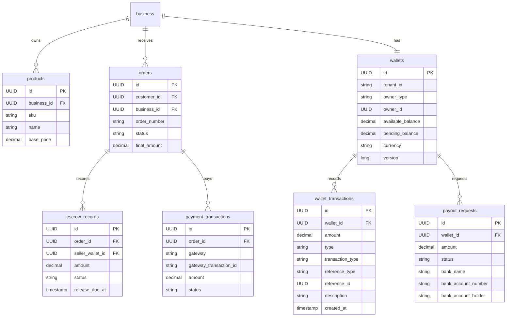

# Kế hoạch Thiết kế & Triển khai Hệ thống Thanh toán Multi-vendor (V-ERP Lite)

Tài liệu này trình bày giải pháp kiến trúc và kế hoạch triển khai chi tiết cho hệ thống Thanh toán (Payment System) đa nhà bán hàng (Multi-vendor) tích hợp trực tiếp vào dự án **V-ERP Lite** (Backend: Quarkus, Frontend: React/Vite, Database: MariaDB, Auth: Keycloak).

---

## 1. Phân Tích Rủi Ro & Thách Thức Kỹ Thuật (Problems Analysis)

Áp dụng hệ thống tài chính vào một codebase Multi-tenant, "Lite" (không sử dụng Redis, Message Queue) mang lại các thách thức lớn sau:

### 1.1. Tranh Chấp Tài Nguyên & Race Conditions
* **Thách thức:** Khi xảy ra giao dịch đồng thời (nhận tiền từ đơn hàng hoàn tất cùng lúc với yêu cầu rút tiền Payout), hai luồng xử lý có thể đọc số dư cũ, tính toán và ghi đè số dư mới dẫn đến thất thoát tiền hoặc âm tài khoản.
* **Điểm yếu hiện tại:** Dự án hiện tại sử dụng Hibernate Panache và chỉ dùng `@Version` (Optimistic Locking). Khóa lạc quan sẽ ném ra `OptimisticLockException` và rollback nếu có va chạm, điều này tốt cho dữ liệu cấu hình nhưng đối với ví tiền chịu tải cao, tỷ lệ lỗi giao dịch sẽ rất lớn, gây trải nghiệm tệ.
* **Giải pháp:** Sử dụng **Pessimistic Locking (Khóa bi quan)** khi cập nhật ví tiền:
  ```java
  Wallet wallet = entityManager.find(Wallet.class, walletId, LockModeType.PESSIMISTIC_WRITE);
  ```
  Thao tác này tương đương lệnh `SELECT ... FOR UPDATE` trong MariaDB, chặn tất cả các luồng khác đọc/ghi dòng này cho đến khi transaction hiện tại kết thúc. Đồng thời bổ sung constraint ở DB: `CHECK (available_balance >= 0)`.

### 1.2. Tính Trùng Lặp & Idempotency
* **Thách thức:** Cổng thanh toán (Stripe, VNPay, MoMo) có cơ chế gọi lại Webhook nhiều lần nếu không nhận được phản hồi 200 OK ngay lập tức. Khách hàng cũng có thể nhấn nút "Thanh toán" hai lần liên tiếp.
* **Điểm yếu hiện tại:** JAX-RS Endpoints hiện tại chưa có cơ chế kiểm tra trùng lặp (Idempotency check).
* **Giải pháp:** Xây dựng bảng `payment_idempotency` lưu trữ `idempotency_key` (hoặc `gateway_transaction_id`). Mọi yêu cầu thanh toán/webhook phải đi qua bộ lọc kiểm tra khóa này:
  1. Nếu khóa đã tồn tại với trạng thái `SUCCESS`, trả về ngay kết quả đã lưu.
  2. Nếu khóa đang được xử lý (`PROCESSING`), chặn hoặc trả về lỗi chờ.
  3. Nếu chưa có, tạo mới và tiếp tục xử lý trong Transaction.

### 1.3. Tính Toàn Vẹn Dữ Liệu Ledger (Double-Entry Bookkeeping)
* **Thách thức:** Việc cộng trừ số dư trực tiếp trên bảng `Wallet` rất dễ bị sai lệch và không thể kiểm toán (audit).
* **Giải pháp:** Thiết kế theo mô hình **Ledger (Sổ cái)**. Số dư ví không bao giờ được thay đổi bằng `setter` tự do. Mọi biến động số dư phải được thực hiện qua `WalletService` và luôn đi kèm với việc tạo bản ghi tương ứng trong bảng `wallet_transactions`. Số dư ví phải luôn bằng tổng (sum) các giao dịch trong lịch sử ví.

### 1.4. Xử Lý Webhook & Quản Lý Vòng Đời Tạm Giữ Tiền (Escrow)
* **Thách thức:** Tiền thanh toán của User phải được giữ ở trạng thái `pending_balance` (Escrow) và chỉ chuyển sang `available_balance` của Seller khi đơn hàng hoàn thành (`COMPLETED`), hoặc hoàn lại cho User nếu đơn bị hủy (`CANCELLED`).
* **Giải pháp:** Thiết kế bảng `escrow_records` để quản lý. Sử dụng cơ chế:
  - **Event-driven:** Lắng nghe cập nhật trạng thái đơn hàng để giải ngân/hoàn tiền.
  - **Scheduled Release:** Sử dụng `@Scheduled` của Quarkus để quét hàng ngày các khoản tạm giữ đã quá hạn khiếu nại (ví dụ: 7 ngày kể từ lúc giao hàng) để tự động giải ngân.

---

## 2. Thiết Kế Database Schema (Flyway Migration V16)

Để hiện thực hóa mô hình Multi-vendor, ta cần bổ sung mối quan hệ giữa sản phẩm với người bán (Business) và thiết lập hệ thống Ví/Giao dịch:



---

## 3. Kế Hoạch Triển Khai 4 Tuần (4-Week Execution Plan)

### Sprint 1: Thiết Kế Database, Sổ Cái Core & Mô Hình Hóa Multi-vendor
* **Mục tiêu:** Hoàn thành hạ tầng cơ sở dữ liệu, phân rã sản phẩm/đơn hàng theo Seller (Business), dựng lõi giao dịch Ví (Ledger).

* **Phân bổ công việc:**
  * **Dev 1 (Tech Lead / DB Arch):**
    - Viết Flyway Migration `V16__add_payment_and_wallet_tables.sql` tạo các bảng: `wallets`, `wallet_transactions`, `escrow_records`, `payout_requests`, `payment_transactions`, `payment_idempotency`.
    - Viết Flyway Migration `V17__link_product_and_order_to_business.sql` bổ sung `business_id` vào `products` và `orders`.
    - Tạo các Entity Java tương ứng kế thừa `BaseEntity` (hoặc `PanacheEntityBase` tùy bảng hệ thống): `Wallet`, `WalletTransaction`, `EscrowRecord`, `PayoutRequest`, `PaymentTransaction`.
  * **Dev 2 (Backend Core):**
    - Hiện thực hóa `WalletService` với các phương thức cốt lõi sử dụng Pessimistic Locking:
      - `createWallet(ownerType, ownerId)`
      - `creditWalletPending(walletId, amount, txnType, refType, refId)` (Nhận tiền tạm giữ)
      - `releaseEscrow(escrowId)` (Chuyển từ pending sang available)
      - `debitWalletAvailable(walletId, amount, txnType, refType, refId)` (Trừ tiền khi rút hoặc hoàn tiền)
  * **Dev 3 (Backend Integration):**
    - Thiết kế cơ chế xử lý Idempotency: Tạo `IdempotencyFilter` hoặc `IdempotencyService` lưu trữ và xác thực khóa giao dịch.
    - Tạo Mock Payment Gateway Service để giả lập việc thanh toán thẻ qua VNPay/Stripe mà không cần gọi API thật ở giai đoạn đầu.
  * **Dev 4 (Frontend UX - Buyer):**
    - Khảo sát mã nguồn Giỏ hàng/Thanh toán hiện tại (`frontend/src/pages/cart-checkout-page.tsx`).
    - Phác thảo lại giao diện Checkout hỗ trợ hiển thị danh sách sản phẩm gom theo từng Seller/Cửa hàng.
  * **Dev 5 (Frontend Dashboard - Seller/Admin):**
    - Thiết lập khung giao diện quản lý Ví cho Seller và màn hình duyệt rút tiền cho Admin.
  * **Dev 6 (QA/QC & DevOps):**
    - Thiết lập môi trường CI chạy Docker Compose với DB MariaDB và Keycloak phục vụ test tự động.
    - Viết Integration Test ban đầu cho `WalletService` để kiểm tra luồng nạp/rút số dư cơ bản.

---

### Sprint 2: Core Wallet Logic, Xử Lý Escrow & Chia Dòng Tiền (Split Payment)
* **Mục tiêu:** Hoàn thiện logic nghiệp vụ ví, tự động chia tiền (Split Payment) sau khi thanh toán thành công và quản lý Escrow.

* **Phân bổ công việc:**
  * **Dev 2 (Backend Core) - Chủ trì Sprint:**
    - Phát triển logic **Split Payment** trong `PaymentService`: Khi đơn hàng thành công, tự động chia `final_amount`:
      - 5% (Platform Commission) -> Chuyển vào Ví Admin/Platform.
      - 95% -> Chuyển vào ví Seller dưới dạng `pending_balance` thông qua `EscrowRecord`.
    - Viết logic giải phóng tiền Escrow (`releaseEscrow`): Cập nhật trạng thái `EscrowRecord` thành `RELEASED`, giảm `pending_balance` và tăng `available_balance` của ví Seller.
  * **Dev 1 (Tech Lead / DB Arch):**
    - Xây dựng Quarkus Scheduler (`EscrowReleaseScheduler`) quét định kỳ mỗi ngày các `escrow_records` có `release_due_at <= NOW()` và `status = 'HELD'` để tự động hoàn tất và giải ngân.
    - Viết các câu query JPA tối ưu để tổng hợp số dư Ledger và đối chiếu với số dư thực tế của Ví để phát hiện sai lệch.
  * **Dev 3 (Backend Integration):**
    - Tạo REST Endpoint nhận Webhook từ cổng thanh toán (`/api/payments/webhook/{gateway}`).
    - Tích hợp logic xử lý Webhook: Ghi nhận webhook vào bảng `webhook_events`, kiểm tra Idempotency, cập nhật trạng thái `PaymentTransaction` thành `SUCCESS` và kích hoạt luồng Split Payment.
  * **Dev 4 (Frontend UX - Buyer):**
    - Xây dựng giao diện thanh toán trực tuyến (chọn phương thức VNPay/Thẻ quốc tế), hiển thị QR code Mock để Buyer thực hiện thanh toán trực quan.
  * **Dev 5 (Frontend Dashboard - Seller/Admin):**
    - Hoàn thiện giao diện Ví Seller (`/dashboard/wallet`): Hiển thị số dư khả dụng (`available_balance`), số dư đóng băng (`pending_balance`), danh sách lịch sử giao dịch (`wallet_transactions`).
  * **Dev 6 (QA/QC & DevOps):**
    - Viết Automation Test kiểm thử đồng thời (Concurrency Test) cho việc nạp rút ví: Giả lập 50 luồng đồng thời rút tiền từ một ví để đảm bảo không bị quá bán (Overdrafting) và không xảy ra deadlock.

---

### Sprint 3: Hoàn Thiện Luồng Payout, Quản Lý Đơn Hàng & Dashboard Admin/Seller
* **Mục tiêu:** Cho phép người bán gửi yêu cầu rút tiền (Payout) về tài khoản ngân hàng, Admin phê duyệt yêu cầu và tích hợp đồng bộ trạng thái đơn hàng với Escrow.

* **Phân bổ công việc:**
  * **Dev 2 (Backend Core):**
    - Xây dựng luồng Payout:
      - API `POST /api/payouts` cho Seller gửi yêu cầu rút tiền. Kiểm tra số dư khả dụng, trừ ngay `available_balance` và giữ ở trạng thái tạm khóa trong ví (hoặc tạo giao dịch Payout PENDING).
      - API `POST /api/payouts/{id}/approve` và `POST /api/payouts/{id}/reject` dành riêng cho Admin. Nếu Approve, tiền trừ hẳn. Nếu Reject, hoàn lại tiền vào `available_balance` của Seller.
  * **Dev 3 (Backend Integration):**
    - Kết nối Webhook giải ngân (nếu có cổng Payout tự động) hoặc viết tính năng xuất file Excel danh sách lệnh chuyển khoản ngân hàng (Batch Payout) định dạng Napas cho Admin dễ duyệt.
    - Tích hợp thay đổi trạng thái đơn hàng: Khi đơn hàng chuyển sang `COMPLETED` (từ API Order), tự động kích hoạt giải ngân Escrow sớm mà không cần đợi Scheduler.
  * **Dev 4 (Frontend UX - Buyer):**
    - Tích hợp hiển thị trạng thái thanh toán trên trang Lịch sử đơn hàng của Buyer.
    - Xây dựng nút "Đã nhận được hàng" (Confirm Receipt) giúp Buyer xác nhận hoàn thành đơn sớm, giải ngân tiền ngay cho Seller.
  * **Dev 5 (Frontend Dashboard - Seller/Admin) - Chủ trì Sprint:**
    - Phát triển giao diện Yêu cầu rút tiền cho Seller (nhập số tiền, thông tin ngân hàng).
    - Phát triển giao diện Admin Payout Management dành cho Admin: Danh sách các yêu cầu rút tiền đang chờ duyệt, các nút Phê duyệt / Từ chối kèm theo ghi chú lý do.
  * **Dev 1 (Tech Lead / DB Arch):**
    - Rà soát tính bảo mật: Thêm phân quyền `@RolesAllowed("businessOwner")` trên các API ví/rút tiền của Seller, và `@RolesAllowed("admin")` trên API phê duyệt.
    - Đảm bảo cơ chế Tenant Isolation hoạt động chính xác cho ví của các Seller thuộc các Tenant khác nhau.
  * **Dev 6 (QA/QC & DevOps):**
    - Kiểm thử hồi quy toàn bộ luồng: Từ lúc Buyer tạo đơn -> Thanh toán thành công -> Tách tiền -> Hoàn thành đơn -> Giải ngân ví -> Rút tiền ví -> Admin phê duyệt.

---

### Sprint 4: Kiểm Thử Hiệu Năng, Đối Soát (Reconciliation) & Đóng Gói Release
* **Mục tiêu:** Kiểm tra bảo mật toàn diện, tối ưu hóa truy vấn Database, đối soát tài chính tự động và đóng gói sản phẩm.

* **Phân bổ công việc:**
  * **Dev 6 (QA/QC & DevOps) - Chủ trì Sprint:**
    - Chạy Performance & Load Test cho hệ thống thanh toán và xử lý ví bằng JMeter hoặc Gatling.
    - Kiểm tra các lỗ hổng bảo mật: Thao túng tham số thanh toán (Parameter Tampering), gửi đè gói tin (Replay Attack).
  * **Dev 1 (Tech Lead / DB Arch):**
    - Phát triển công cụ tự động đối soát nội bộ (Internal Reconciliation Task): Quét định kỳ đối chiếu chéo tổng `wallet_transactions` của mỗi ví phải luôn bằng đúng `available_balance + pending_balance`. Nếu phát hiện sai lệch, tự động khóa ví và cảnh báo hệ thống.
    - Tạo các database indexes tối ưu cho bảng giao dịch ví và bảng đối soát để tránh khóa bảng lâu khi dữ liệu lớn.
  * **Dev 2 (Backend Core) & Dev 3 (Backend Integration):**
    - Sửa lỗi phát sinh từ kết quả QA.
    - Đóng gói tài liệu API chuẩn OpenAPI/Swagger. Chạy `npm run generate-api` trên frontend để đồng bộ hóa SDK sạch sẽ lần cuối.
  * **Dev 4 (Frontend UX) & Dev 5 (Frontend Dashboard):**
    - Kiểm tra responsive giao diện ví, lịch sử giao dịch và luồng thanh toán trên các thiết bị Mobile/Tablet.
    - Tối ưu hóa UI/UX: Hiển thị các loading state trực quan, thông báo Toast báo lỗi/thành công mượt mà.
  * **Cả đội ngũ:**
    - Thực hiện Demo hệ thống. Deploy lên môi trường Staging kiểm thử tích hợp cuối cùng trước khi bàn giao.

---

## 4. Chi Tiết File Cần Tạo / Chỉnh Sửa (Detailed WBS)

Dưới đây là danh mục chi tiết các file trong dự án cần được tạo mới hoặc thay đổi, phân chia cụ thể cho từng vị trí Developer để phục vụ cho việc quản lý mã nguồn:

### 4.1. Tầng Database & Entities (Dev 1 phụ trách chính)

* **[NEW]** `src/main/resources/db/migration/V16__add_payment_and_wallet_tables.sql`
  - Định nghĩa cấu trúc các bảng tài chính cốt lõi: `wallets`, `wallet_transactions`, `escrow_records`, `payout_requests`, `payment_transactions`, `payment_idempotency`.
* **[NEW]** `src/main/resources/db/migration/V17__link_product_and_order_to_business.sql`
  - Bổ sung cột `business_id` (UUID) tham chiếu bảng `business` vào các bảng `products` và `orders`.
* **[NEW]** [Wallet.java](file:///c:/Users/5530/Documents/GitHub/v-erp-lite/src/main/java/base/entity/Wallet.java)
  - JPA Entity ánh xạ bảng `wallets`. Kế thừa `BaseEntity` (có sẵn `tenantId`, `@Version` để chống xung đột bằng Optimistic Lock phụ).
* **[NEW]** [WalletTransaction.java](file:///c:/Users/5530/Documents/GitHub/v-erp-lite/src/main/java/base/entity/WalletTransaction.java)
  - JPA Entity ghi nhận vết giao dịch sổ cái (Ledger Entry).
* **[NEW]** [EscrowRecord.java](file:///c:/Users/5530/Documents/GitHub/v-erp-lite/src/main/java/base/entity/EscrowRecord.java)
  - JPA Entity quản lý trạng thái tạm giữ tiền trung gian của đơn hàng.
* **[NEW]** [PayoutRequest.java](file:///c:/Users/5530/Documents/GitHub/v-erp-lite/src/main/java/base/entity/PayoutRequest.java)
  - JPA Entity xử lý các yêu cầu rút tiền của Seller.
* **[MODIFY]** [Product.java](file:///c:/Users/5530/Documents/GitHub/v-erp-lite/src/main/java/base/entity/Product.java)
  - Bổ sung thuộc tính `private Business business` xác định sản phẩm thuộc cửa hàng nào.
* **[MODIFY]** [Order.java](file:///c:/Users/5530/Documents/GitHub/v-erp-lite/src/main/java/base/entity/Order.java)
  - Bổ sung thuộc tính `private Business business` để phân tách đơn hàng đơn lẻ theo Seller.

### 4.2. Tầng Nghiệp Vụ Core Backend (Dev 2 phụ trách chính)

* **[NEW]** [WalletService.java](file:///c:/Users/5530/Documents/GitHub/v-erp-lite/src/main/java/base/service/WalletService.java)
  - Lớp nghiệp vụ thực hiện cộng/trừ ví sử dụng `LockModeType.PESSIMISTIC_WRITE` và cập nhật transaction song song.
* **[NEW]** [PaymentService.java](file:///c:/Users/5530/Documents/GitHub/v-erp-lite/src/main/java/base/service/PaymentService.java)
  - Logic phân chia tỷ lệ dòng tiền (Split Payment) và thanh toán.
* **[NEW]** [EscrowService.java](file:///c:/Users/5530/Documents/GitHub/v-erp-lite/src/main/java/base/service/EscrowService.java)
  - Quản lý logic tạm giữ tiền của khách hàng, giải ngân cho nhà bán.
* **[NEW]** [WalletResource.java](file:///c:/Users/5530/Documents/GitHub/v-erp-lite/src/main/java/base/rest/WalletResource.java)
  - JAX-RS Resource cung cấp các API endpoint truy vấn số dư và lịch sử giao dịch ví.
* **[NEW]** [PayoutResource.java](file:///c:/Users/5530/Documents/GitHub/v-erp-lite/src/main/java/base/rest/PayoutResource.java)
  - JAX-RS Resource phục vụ API tạo lệnh rút tiền, phê duyệt/từ chối lệnh rút tiền.
* **[MODIFY]** [OrderResource.java](file:///c:/Users/5530/Documents/GitHub/v-erp-lite/src/main/java/base/rest/OrderResource.java)
  - Tích hợp gọi sang `EscrowService` để giải ngân tiền khi đơn hàng hoàn thành thành công.

### 4.3. Tầng Tích Hợp Cổng Thanh Toán & Webhooks (Dev 3 phụ trách chính)

* **[NEW]** [IdempotencyService.java](file:///c:/Users/5530/Documents/GitHub/v-erp-lite/src/main/java/base/service/IdempotencyService.java)
  - Kiểm tra, lưu giữ các khóa idempotency key để loại bỏ giao dịch trùng lặp.
* **[NEW]** [PaymentGatewayService.java](file:///c:/Users/5530/Documents/GitHub/v-erp-lite/src/main/java/base/service/PaymentGatewayService.java)
  - Khởi tạo đường link thanh toán (giả lập hoặc kết nối API VNPay/Stripe thật).
* **[NEW]** [PaymentWebhookResource.java](file:///c:/Users/5530/Documents/GitHub/v-erp-lite/src/main/java/base/rest/PaymentWebhookResource.java)
  - Nơi tiếp nhận Webhooks gọi lại từ phía Cổng thanh toán để cập nhật dữ liệu.

### 4.4. Tầng Giao Diện Buyer UX (Dev 4 phụ trách chính)

* **[MODIFY]** [cart-checkout-page.tsx](file:///c:/Users/5530/Documents/GitHub/v-erp-lite/frontend/src/pages/cart-checkout-page.tsx)
  - Cập nhật giao diện thanh toán, chia sản phẩm trong giỏ theo Seller và cho phép chọn thanh toán qua ví/cổng.
* **[NEW]** [payment-processing-page.tsx](file:///c:/Users/5530/Documents/GitHub/v-erp-lite/frontend/src/pages/payment-processing-page.tsx)
  - Màn hình chờ thanh toán/hiển thị QR để người mua quét mã.
* **[MODIFY]** [order-detail-page.tsx](file:///c:/Users/5530/Documents/GitHub/v-erp-lite/frontend/src/pages/order-detail-page.tsx)
  - Hiển thị thông tin tiến độ dòng tiền tạm giữ và thêm nút xác nhận đơn.

### 4.5. Tầng Giao Diện Seller & Admin Dashboard (Dev 5 phụ trách chính)

* **[NEW]** [seller-wallet-page.tsx](file:///c:/Users/5530/Documents/GitHub/v-erp-lite/frontend/src/pages/seller-wallet-page.tsx)
  - Màn hình quản lý Ví của Seller: hiển thị số dư, giao dịch, form rút tiền.
* **[NEW]** [admin-payouts-page.tsx](file:///c:/Users/5530/Documents/GitHub/v-erp-lite/frontend/src/pages/admin/admin-payouts-page.tsx)
  - Màn hình phê duyệt giao dịch rút tiền dành cho Admin hệ thống.
* **[MODIFY]** [routes/_authenticated.tsx](file:///c:/Users/5530/Documents/GitHub/v-erp-lite/frontend/src/routes/_authenticated.tsx)
  - Tích hợp thêm các route mới vào Menu điều hướng của trang ứng dụng.

### 4.6. Tầng QA & DevOps Automation (Dev 6 phụ trách chính)

* **[NEW]** `src/test/java/base/service/WalletServiceConcurrencyTest.java`
  - Integration Tests chạy bằng Quarkus Test để giả lập race condition trên ví số dư.
* **[NEW]** `src/test/java/base/rest/PaymentWebhookResourceTest.java`
  - Integration Tests giả lập luồng webhook thanh toán gửi lặp lại và kiểm tra Idempotency.

---

## 5. Kế Hoạch Xác Minh & Kiểm Thử (Verification Plan)

### Kiểm Thử Tự Động (Automated Tests)
Chạy bộ test kiểm thử tích hợp để xác minh hoạt động của Core Wallet và khả năng chịu tải đồng thời:
```bash
./gradlew test --tests "base.service.WalletServiceConcurrencyTest"
./gradlew test --tests "base.rest.PaymentWebhookResourceTest"
```

### Kiểm Thử Thủ Công (Manual Verification)
1. Sử dụng Keycloak đăng nhập dưới tài khoản Seller (ví dụ `seller1@v-erp.com`), truy cập `/dashboard/wallet` để kiểm tra ví tự động khởi tạo bằng 0.
2. Dùng tài khoản Buyer thực hiện mua hàng từ Seller này. Tiến hành thanh toán qua Mock QR Code.
3. Kiểm tra DB xem đơn hàng đã cập nhật trạng thái thanh toán chưa, ví Admin tăng 5%, ví Seller tăng 95% ở mục số dư đóng băng (`pending_balance`).
4. Dùng tài khoản Buyer nhấn nút "Xác nhận nhận hàng" (hoặc giả lập thời gian trôi qua 7 ngày). Kiểm tra số dư của Seller chuyển từ `pending_balance` sang `available_balance`.
5. Thực hiện gửi yêu cầu rút tiền từ tài khoản Seller. Đăng nhập tài khoản Admin phê duyệt lệnh rút tiền, kiểm tra số dư khả dụng bị trừ chuẩn xác.
